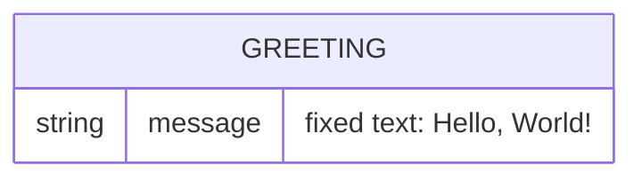

# Domain model

The product has a single concept: the greeting returned by the API and shown on the page. Nothing is stored.

The greeting is a constant owned by the API; there are no persisted entities or relations.